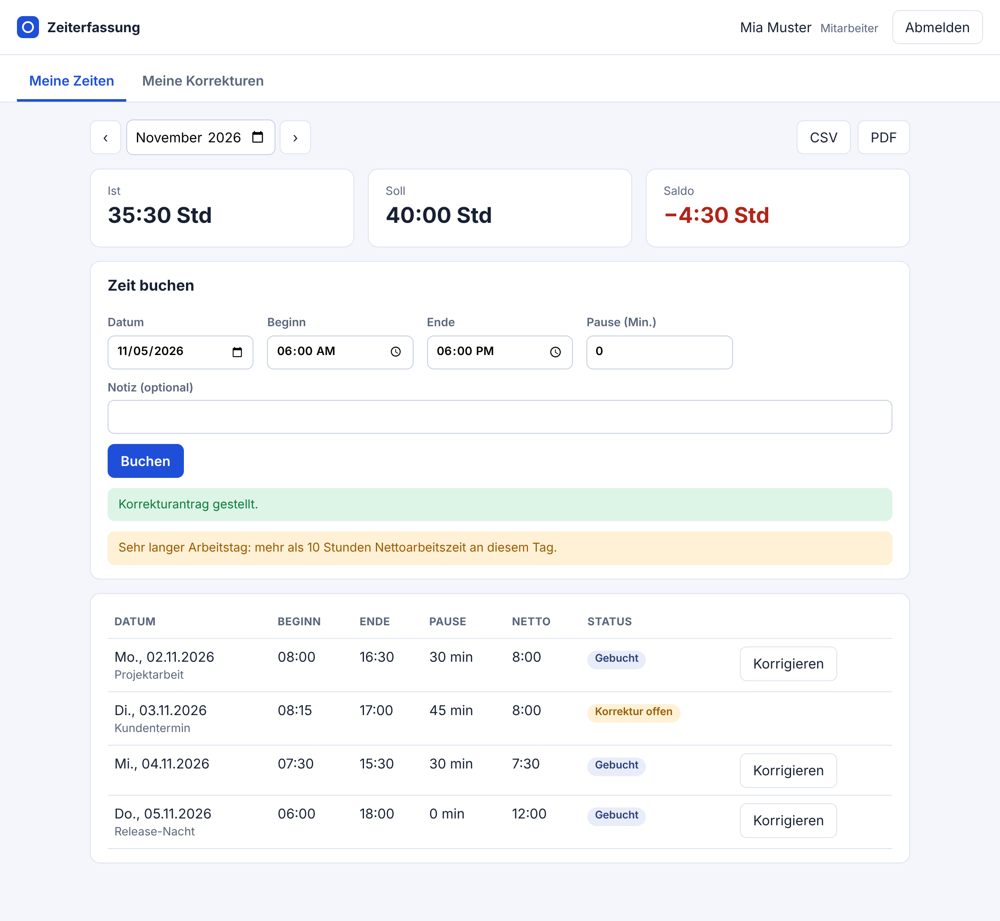
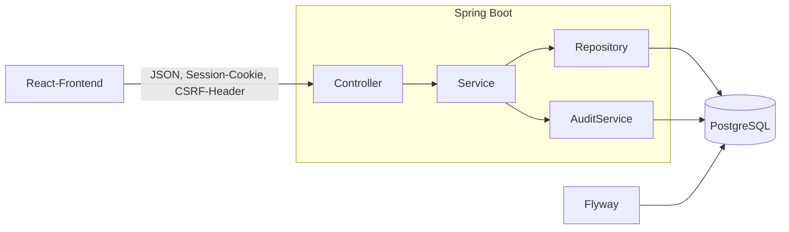
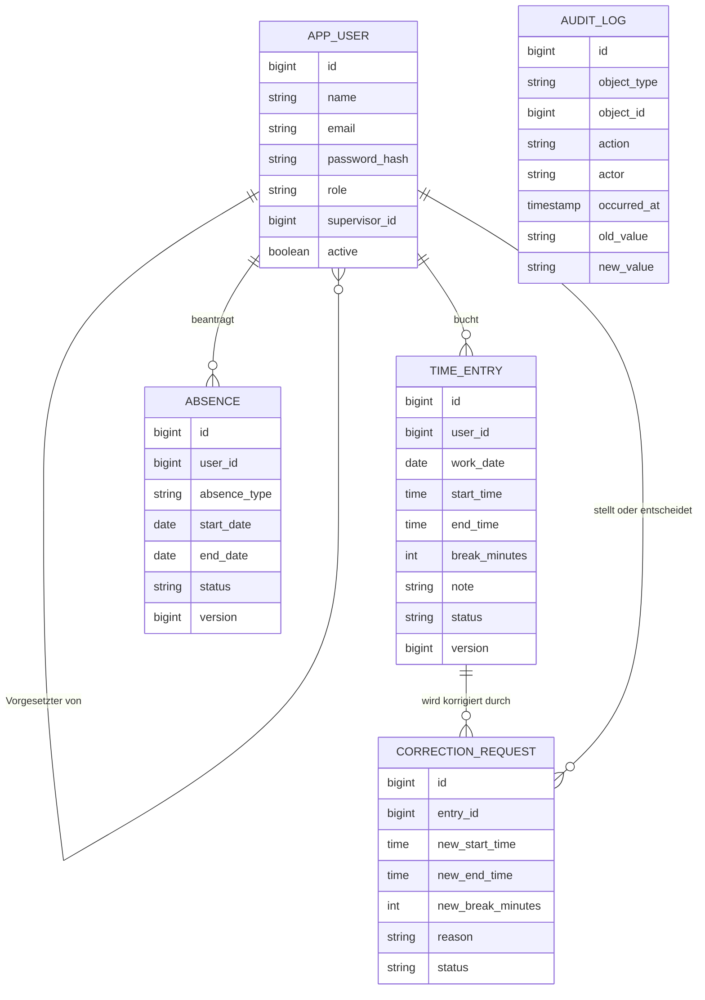

# Zeiterfassung

Eine Webanwendung für die Arbeitszeiterfassung. Mitarbeiter buchen ihre Zeiten online, Vorgesetzte genehmigen
Korrekturen und Urlaub. Sie ersetzt papierbasierte Stundenzettel.

Gebaut mit Java 21, Spring Boot 3, PostgreSQL und React.



## Was die Anwendung kann

- Anmeldung mit drei Rollen: Mitarbeiter, Vorgesetzter, Administrator.
- Zeiten buchen mit Datum, Beginn, Ende, Pause und Notiz.
- Prüfungen beim Buchen: Ende nach Beginn, keine Überschneidung mit anderen Buchungen, Pause nicht länger als die Arbeitszeit, kein Datum in der Zukunft. Ab mehr als 10 Stunden Nettoarbeitszeit am Tag und an Feiertagen gibt es einen Hinweis.
- Gebuchte Zeiten werden nie direkt geändert. Wer sich vertan hat, stellt einen Korrekturantrag mit Begründung. Der Vorgesetzte genehmigt oder lehnt ab (bei Ablehnung mit Kommentar).
- Urlaub, Krankheit und sonstige Abwesenheiten. Urlaub muss genehmigt werden und wird gegen den Jahresanspruch gerechnet (30 Tage, einstellbar). Krankheit und Sonstiges gelten sofort. Eine Abwesenheit lässt sich zurückziehen.
- Feiertage für Nordrhein-Westfalen. Die beweglichen Feiertage werden aus dem Ostersonntag berechnet, es gibt also keine Liste pro Jahr, die jemand pflegen muss.
- Monatsübersicht mit Ist, Soll und Saldo. Feiertage und genehmigte Abwesenheiten haben kein Soll.
- Export des Monats als CSV oder PDF.
- Vorgesetzte sehen die Buchungen ihres Teams (nur lesen) und die offenen Anträge.
- Änderungsprotokoll: wer hat wann was geändert, mit altem und neuem Wert.
- API-Dokumentation mit Swagger UI unter `/swagger-ui.html`.

Weitere Screenshots: [Abwesenheiten](docs/screenshots/05-abwesenheiten.png), [Genehmigung](docs/screenshots/03-genehmigung.png), [Verwaltung und Protokoll](docs/screenshots/04-verwaltung-protokoll.png).

## Starten

Mit Docker:

```bash
docker compose up --build
```

Danach läuft die Anwendung auf `http://localhost:8080`. In der Compose-Datei sind Demo-Daten eingeschaltet
(`SEED_DEMO_DATA=true`). Es gibt dann vier Benutzer, alle mit dem Passwort `demo-passwort-1`:

| Benutzer | Rolle |
|---|---|
| `admin@example.test` | Administrator |
| `chef@example.test` | Vorgesetzter von Mia und Ben |
| `mia@example.test` | Mitarbeiterin |
| `ben@example.test` | Mitarbeiter |

Für echten Betrieb `SEED_DEMO_DATA=false` setzen. Dann muss der erste Administrator direkt in der Datenbank
angelegt werden (mit BCrypt-Hash), alle weiteren Benutzer legt er in der Verwaltung an.

Ohne Docker braucht man PostgreSQL 16 mit einer Datenbank und einem Benutzer namens `zeiterfassung`:

```bash
cd frontend && npm ci && npm run build && cd ..
SEED_DEMO_DATA=true mvn spring-boot:run
```

Zum Entwickeln am Frontend: `npm run dev` im Ordner `frontend`. Der Dev-Server läuft auf Port 5173 und leitet `/api` an Port 8080 weiter.

Einstellungen über Umgebungsvariablen: `DB_URL`, `DB_USER`, `DB_PASSWORD`, `SEED_DEMO_DATA`,
`VACATION_DAYS_PER_YEAR` und `SESSION_COOKIE_SECURE` (auf `true` setzen, sobald die Seite über HTTPS läuft).

## Aufbau



Controller nehmen Anfragen an und prüfen die Rolle. Die Regeln und Transaktionen liegen in den Services, die
Datenbank wird über Spring Data JPA angesprochen. Nach außen gehen nur DTOs (`Dto.java`), nie die Entities.

Das React-Frontend wird mit Vite gebaut und von Spring Boot als statische Dateien ausgeliefert. Es gibt also nur
einen Dienst und kein CORS.

Das Datenbankschema liegt in Flyway-Migrationen (`src/main/resources/db/migration`). Hibernate prüft es nur
(`ddl-auto: validate`) und ändert nichts.

Fehler kommen einheitlich als `ProblemDetail` (RFC 9457) und enthalten keine internen Details.

## Datenmodell



## Sicherheit

- Passwörter liegen nur als BCrypt-Hash in der Datenbank. Beim Anlegen sind mindestens 10 Zeichen nötig.
- Das Session-Cookie ist `HttpOnly` und `SameSite=Lax`.
- Schreibende Aufrufe sind gegen CSRF geschützt. Das Token steht im Cookie `XSRF-TOKEN` und muss als Header `X-XSRF-TOKEN` zurückkommen.
- Rechte werden zweimal geprüft: mit `@PreAuthorize` am Endpunkt und in den Services, ob die Person überhaupt für dieses Team zuständig ist. Fremde Buchungen und Anträge antworten mit „nicht gefunden“, damit man ihre Existenz nicht erraten kann.
- Eigene Anträge kann man nicht selbst genehmigen.
- Der CSV-Export neutralisiert Zellen, die mit `=`, `+`, `-` oder `@` beginnen, damit Excel sie nicht als Formel ausführt.
- Es gibt eine Content-Security-Policy und `X-Frame-Options: DENY`.

Zum Datenschutz: Zeiterfassung enthält personenbezogene Daten, deshalb sieht jeder nur die eigenen Daten bzw. die des
eigenen Teams. Wer das Unternehmen verlässt, wird deaktiviert statt gelöscht, damit das Protokoll vollständig bleibt.
Konkrete Aufbewahrungs- und Löschfristen muss man für den jeweiligen Einsatz rechtlich klären.

## Tests

```bash
mvn verify
```

Es sind 49 Tests: Unit-Tests mit JUnit 5 und Mockito (Arbeitszeitberechnung, Plausibilitätsregeln, Feiertagsberechnung,
CSV-Schutz) und Integrationstests mit Spring Boot und MockMvc (Anmeldung, CSRF, Rollen, Korrekturablauf, Urlaub,
Export, Fehlerantworten, optimistisches Locking).

Gezielt abgedeckt sind unter anderem die Zeitumstellung am 30.03.2025 und 26.10.2025, Überschneidungen,
Feiertage in NRW (2025 und 2026), Urlaub über den Jahresanspruch hinaus, Zugriff auf Daten anderer Teams.

Die Abdeckung, gemessen mit JaCoCo bei `mvn verify`: 92,1 % der Instruktionen, 92,9 % der Zeilen und 76,6 % der
Verzweigungen. Der Bericht liegt danach in `target/site/jacoco/index.html`, in der CI wird er als Artefakt gespeichert.

Die Tests laufen gegen H2 im PostgreSQL-Modus mit denselben Flyway-Migrationen. Zusätzlich wurde die Anwendung
von Hand gegen PostgreSQL 16 durchgespielt: Anmeldung, Buchen, Korrektur, Urlaubsantrag, Genehmigung, Export, Protokoll.

Rückmeldungen von Testnutzern gibt es noch nicht.

## Was fehlt oder nicht gut ist

- Feiertage sind nur für Nordrhein-Westfalen hinterlegt. Halbe Feiertage (24.12., 31.12.) werden wie normale Arbeitstage behandelt.
- Das Soll ist für alle gleich: 8 Stunden an Werktagen. Teilzeit und individuelle Arbeitszeitmodelle gibt es nicht.
- Eine Buchung gilt für einen Kalendertag. Schichten über Mitternacht müssen als zwei Buchungen erfasst werden.
- Keine Erinnerungs-E-Mails und keine zweite Sprache in der Oberfläche.
- Es gibt keine Sperre gegen wiederholte falsche Anmeldungen und kein Zurücksetzen von Passwörtern.
- Benutzer lassen sich anlegen, aber noch nicht bearbeiten oder in der Oberfläche deaktivieren.
- Das Docker-Setup ist nicht automatisiert getestet. Die Tests nutzen H2 statt Testcontainers mit echter PostgreSQL.
- Es gibt keine automatisierten Browser-Tests.

## Weiterlesen

- [Architekturentscheidungen](docs/ENTSCHEIDUNGEN.md): warum es so gebaut ist und wo im Code man es findet.
- OpenAPI: `/v3/api-docs` und `/swagger-ui.html` auf dem laufenden Server.

## Lizenz

MIT, siehe [LICENSE](LICENSE).
