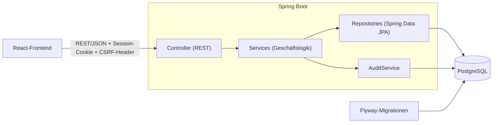
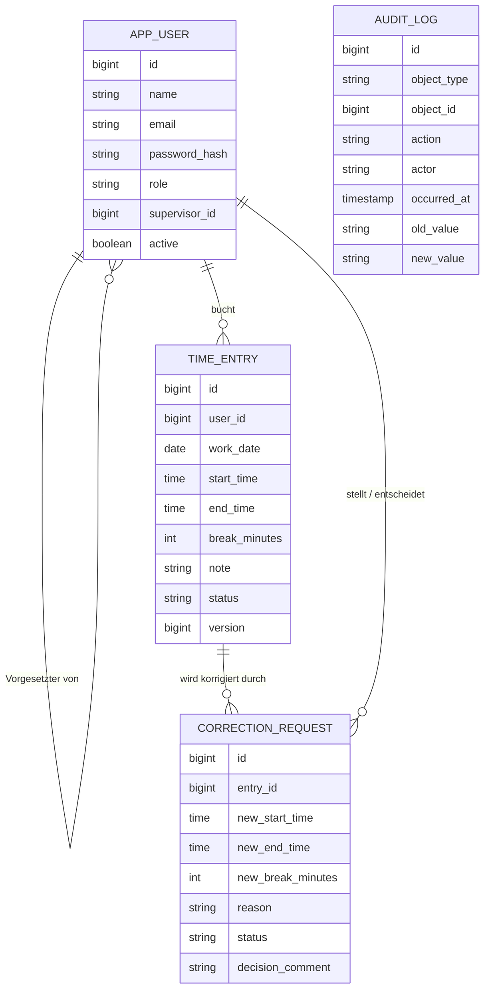

# Digitale Zeiterfassung

Webanwendung, die eine papierbasierte Zeiterfassung ersetzt: Mitarbeiter erfassen ihre Arbeitszeiten online,
Korrekturen laufen über einen Antrag mit Genehmigung durch den Vorgesetzten, und jede Änderung wird protokolliert.

**Technologien:** Java 21, Spring Boot 3.4, Spring Security, Spring Data JPA, PostgreSQL, Flyway, React (Vite), Docker


## Funktionen

| Bereich | Umfang |
|---|---|
| Anmeldung und Rollen | Mitarbeiter, Vorgesetzter, Administrator; Passwörter mit BCrypt, CSRF-Schutz, rollenbasierte Zugriffe |
| Zeitbuchung | Datum, Beginn, Ende, Pause, Notiz |
| Plausibilitätsprüfung | Ende nach Beginn, keine Überschneidungen, Pause nicht länger als die Arbeitszeit, keine Buchung in der Zukunft, Warnung bei mehr als 10 Stunden Nettoarbeitszeit am Tag |
| Korrektur | Der Mitarbeiter stellt einen Antrag mit Begründung, der Vorgesetzte genehmigt oder lehnt ab (Ablehnung nur mit Kommentar). Buchungen werden nie still überschrieben |
| Auswertung | Monatsübersicht mit Ist, Soll und Saldo |
| Export | Monatsübersicht als CSV (Semikolon, UTF-8, Schutz vor Formel-Injection) und PDF |
| Team | Vorgesetzte sehen die Buchungen ihres Teams (nur lesend) und die offenen Anträge |
| Änderungsprotokoll | Wer hat wann was geändert, mit altem und neuem Wert (nur Anhängen, keine Änderung über die Anwendung) |
| API-Dokumentation | OpenAPI und Swagger UI unter `/swagger-ui.html` |

Nicht umgesetzt (siehe „Grenzen“): Urlaub und Abwesenheiten, Feiertagskalender, Erinnerungs-E-Mails, mehrsprachige Oberfläche.

## Schnellstart

Mit Docker:

```bash
docker compose up --build
```

Danach `http://localhost:8080` öffnen. Mit `SEED_DEMO_DATA=true` (Standard in `docker-compose.yml`) werden vier
Demo-Benutzer angelegt, alle mit dem Passwort `demo-passwort-1`:

| Benutzer | Rolle |
|---|---|
| `admin@example.test` | Administrator |
| `chef@example.test` | Vorgesetzter (Team: Mia, Ben) |
| `mia@example.test` | Mitarbeiter |
| `ben@example.test` | Mitarbeiter |

Die Demo-Daten sind nur für die Vorführung gedacht. In Produktion `SEED_DEMO_DATA=false` setzen und die Benutzer über die
Verwaltung anlegen. Der erste Administrator muss dann direkt in der Datenbank angelegt werden (BCrypt-Hash).

Ohne Docker (PostgreSQL 16 mit Datenbank und Benutzer `zeiterfassung` vorausgesetzt):

```bash
cd frontend && npm ci && npm run build && cd ..
SEED_DEMO_DATA=true mvn spring-boot:run
```

Für die Frontend-Entwicklung: `npm run dev` im Ordner `frontend` (Port 5173, leitet `/api` an Port 8080 weiter).

## Architektur



- **Schichten:** Controller nehmen Anfragen an und prüfen Rechte, Services enthalten die Regeln und die Transaktionen, Repositories greifen auf die Datenbank zu. Entities verlassen die Service-Schicht nie, nach außen gehen nur DTOs (`Dto.java`).
- **Frontend:** React mit Vite. Das Build wird von Spring Boot als statische Dateien ausgeliefert, es gibt also nur einen Dienst und keine CORS-Konfiguration.
- **Datenbankschema:** versioniert mit Flyway (`src/main/resources/db/migration`), Hibernate prüft es nur (`ddl-auto: validate`).
- **Fehler:** einheitliche Antworten nach RFC 9457 (`ProblemDetail`), ohne interne Details.

## Datenmodell



## Sicherheit

- Passwörter nur als BCrypt-Hash, Mindestlänge 10 Zeichen bei der Anlage.
- Session-Cookie mit `HttpOnly` und `SameSite=Lax` (`Secure` per `SESSION_COOKIE_SECURE=true` hinter HTTPS).
- CSRF-Schutz für alle schreibenden Aufrufe (Cookie `XSRF-TOKEN`, Header `X-XSRF-TOKEN`).
- Rechte doppelt abgesichert: `@PreAuthorize` an den Endpunkten und Prüfung der Zugehörigkeit in den Services. Fremde Anträge und Buchungen liefern „nicht gefunden“, damit sie nicht erkennbar sind.
- Eigene Korrekturanträge können nicht selbst entschieden werden.
- Sicherheits-Header (Content-Security-Policy, `X-Frame-Options`), CSV-Export gegen Formel-Injection geschützt.

Datenschutz: Zeiterfassungsdaten sind personenbezogen. Zugriff gibt es nur auf eigene Daten beziehungsweise die des Teams.
Ausgeschiedene Personen werden deaktiviert (`active = false`) statt gelöscht, damit die Nachvollziehbarkeit erhalten bleibt.
Konkrete Aufbewahrungs- und Löschfristen müssen je nach Einsatz rechtlich geklärt werden.

## Tests

```bash
mvn verify
```

- 34 Tests: Unit-Tests (JUnit 5, Mockito) für Arbeitszeitberechnung und Plausibilitätsregeln, Integrationstests mit Spring Boot und MockMvc für Sicherheit, Rollen, Korrekturablauf, Export, Fehlerbehandlung und optimistisches Locking.
- Besondere Fälle: Sommer- und Winterzeitumstellung (30.03.2025 und 26.10.2025), Überschneidungen, CSRF, Zugriff auf fremde Daten.
- **Abdeckung (JaCoCo, gemessen mit `mvn verify`):** 91,0 % der Instruktionen, 91,9 % der Zeilen, 77,0 % der Verzweigungen. Den Bericht gibt es unter `target/site/jacoco/index.html` und als Artefakt der CI.
- Die Tests laufen gegen H2 im PostgreSQL-Modus (dieselben Flyway-Migrationen). Zusätzlich wurde die Anwendung von Hand gegen PostgreSQL 16 durchgespielt (Anmeldung, Buchen, Korrektur, Genehmigung, Export, Protokoll).

Rückmeldungen von Testnutzern: noch nicht durchgeführt.

## Grenzen und bekannte Schwächen

- Kein Urlaub, keine Abwesenheiten und kein Feiertagskalender: Das Soll wird nur aus Werktagen (Mo bis Fr, 8 Stunden) berechnet, Feiertage mindern es nicht.
- Pro Buchung gilt ein Kalendertag. Schichten über Mitternacht müssen als zwei Buchungen erfasst werden.
- Keine Sperre gegen wiederholte Fehlanmeldungen (Brute-Force) und kein Passwort-Zurücksetzen.
- Benutzer können angelegt, aber noch nicht bearbeitet oder über die Oberfläche deaktiviert werden.
- Das Docker-Setup ist bisher nicht automatisiert getestet. Die Tests nutzen H2 statt Testcontainers mit echter PostgreSQL.
- Es gibt keine automatisierten Ende-zu-Ende-Tests im Browser.

## Weitere Dokumentation

- [Architekturentscheidungen und Antworten auf typische Fragen](docs/ENTSCHEIDUNGEN.md)
- OpenAPI: `http://localhost:8080/v3/api-docs`, Oberfläche unter `http://localhost:8080/swagger-ui.html`

## Lizenz

MIT, siehe [LICENSE](LICENSE).
